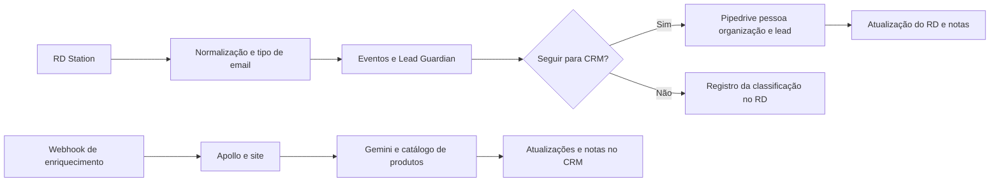
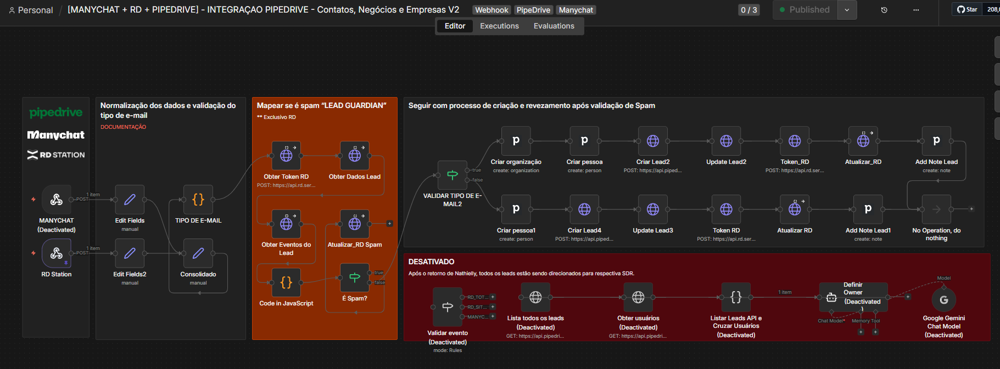
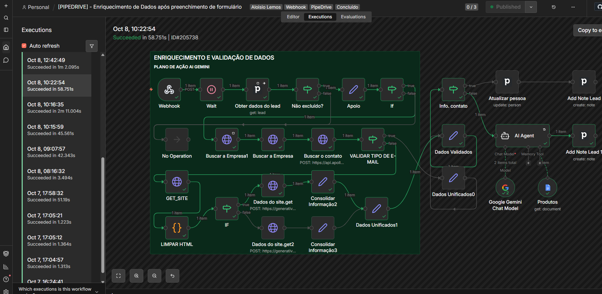

# Lead Guardian e enriquecimento — RD Station → Pipedrive

Desenvolvi esta integração para transformar entradas de leads em registros coerentes no CRM, combinando **n8n, RD Station, Pipedrive, APIs, JavaScript, Apollo e Gemini**. Separei a recepção e validação do enriquecimento para organizar as responsabilidades da operação.

## O problema e a entrega

Precisava tratar origens diferentes, e-mails pessoais e corporativos, conversões suspeitas e dados incompletos antes de disponibilizar o contexto ao comercial. Construí a normalização, o Lead Guardian, a criação de pessoas e organizações quando aplicável e as atualizações entre CRM e RD. Em outro workflow, implementei o enriquecimento e a geração de contexto comercial com IA.

O RD permanece em uso diário na minha operação. A entrada ManyChat está desativada no export, assim como a distribuição histórica por responsável com Gemini. O enriquecimento contém um agente e um modelo Gemini habilitados no original. Na cópia pública, as integrações estão desativadas.

## Lead Guardian: regra verificável

O código consulta eventos de conversão, descarta datas inválidas, ordena as datas e calcula a diferença entre o primeiro e o último evento recebido. Classifica como spam quando há pelo menos dois eventos e o intervalo total é de até 60 segundos. Retorna status, ação, motivos e enviar_pipedrive. Não há nó de espera no workflow de entrada: a janela é calculada pelos timestamps.

Essa heurística pode sinalizar conversões legítimas repetidas e deixar passar padrões diferentes de spam. A informação ja_sincronizado é calculada a partir da bio, mas não bloqueia por si só uma nova criação. Portanto, esse código não garante idempotência nem eliminação de todos os spams.

## Enriquecimento com IA

O segundo fluxo recebe um webhook, aguarda, consulta o lead e verifica se não foi excluído. As ramificações buscam empresa e contato, incluindo Apollo, obtêm conteúdo do site e limpam HTML. Os dados são consolidados para atualizar pessoa, registrar notas e apoiar o agente Gemini com conhecimento de produtos. O tempo de espera não foi arbitrado nesta publicação: o export informa a unidade e omite a quantidade.

Os prompts privados foram substituídos por instruções demonstrativas. O documento de produtos deve ser configurado com conteúdo próprio. Saídas do modelo exigem revisão e não comprovam informações ausentes nas fontes.

O diagrama agrupa responsabilidades. O export não contém uma chamada direta do primeiro workflow ao webhook de enriquecimento; configure o evento correspondente na instalação de destino.

## Screenshots

Envie os arquivos com os nomes acima para assets/screenshots/. Os links já estão preparados.

## Arquivos e reprodução

- [Template entrada](workflows/entrada.template.json) — 39 nós.
- [Inventário e códigos entrada](docs/inventario-entrada.md)
- [Template enriquecimento](workflows/enriquecimento.template.json) — 29 nós.
- [Inventário e códigos enriquecimento](docs/inventario-enriquecimento.md)
- [Arquitetura e vínculos](docs/arquitetura.md)
- [Configuração](docs/configuracao.md)
- [Preparação pública](docs/publicacao.md)
- [Validação](docs/validacao.md)

## Projetos conectados

- [Notificações operacionais — CRM, Airbyte e Teams](https://github.com/alosiolemos/n8n-crm-airbyte-teams-notifications)
- [Monitor de falhas — n8n e Microsoft Teams](https://github.com/alosiolemos/n8n-error-monitor-teams-alerts)

Os projetos documentam partes complementares da operação. Seus gatilhos e configurações devem ser associados na instalação de destino.
